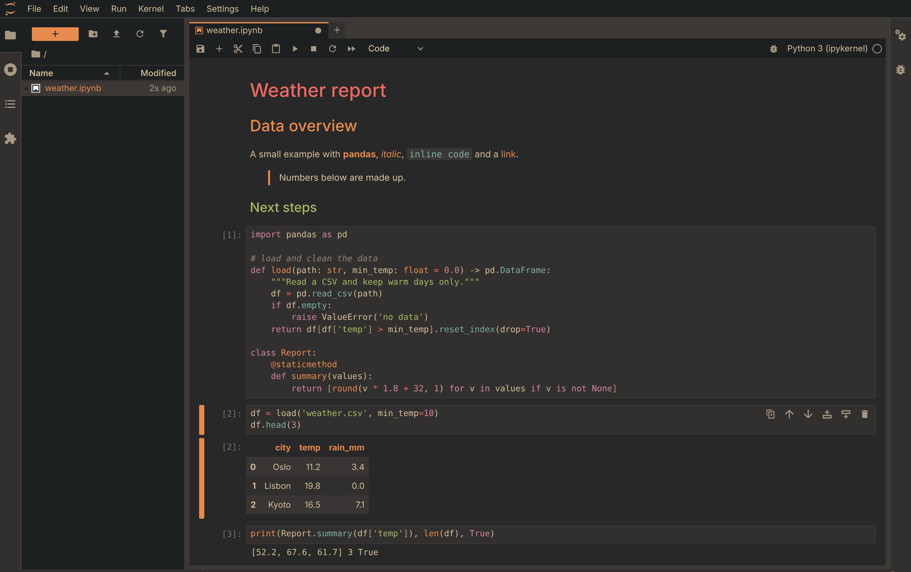

# jupyterlab_gruvbox_material

Gruvbox Material (dark) theme for JupyterLab 4.

A soft, low-contrast gruvbox look: warm beige text, an orange accent, colored
headings and darker side panels, in the Gruvbox Material palette.



## Requirements

- JupyterLab 4.x (tested on 4.5.11)

Still on JupyterLab 3? Use the 1.x line, see [below](#jupyterlab-3).

## Install

```bash
pip install jupyterlab-gruvbox-material
```

Restart JupyterLab, then choose **Settings → Theme → Gruvbox Material**.

Each [release](https://github.com/mergelangelo/jupyterlab-gruvbox-material/releases) also has the wheel attached,
so you can install a specific version straight from GitHub.

## JupyterLab 3

Versions 1.x support JupyterLab 3. Pin the version so pip does not pick 2.x:

```bash
pip install "jupyterlab-gruvbox-material<2"
```

The source for 1.x lives on the [`jupyterlab-3`](https://github.com/mergelangelo/jupyterlab-gruvbox-material/tree/jupyterlab-3) branch.

## Uninstall

```bash
pip uninstall jupyterlab_gruvbox_material
```

## Customizing colors

All colors live in [`style/material.css`](style/material.css). Change the values there
and rebuild (see below).

## Building from source

Requires Node.js 18+ and Python 3.9+.

```bash
pip install "jupyterlab>=4.5,<4.6" build
python -m build
```

The wheel is written to `dist/`. For development, `pip install -e .` followed by
`jupyter labextension develop . --overwrite` links the extension into JupyterLab;
`jlpm build` rebuilds it after changes.

## License

BSD-3-Clause, see [LICENSE](LICENSE).
